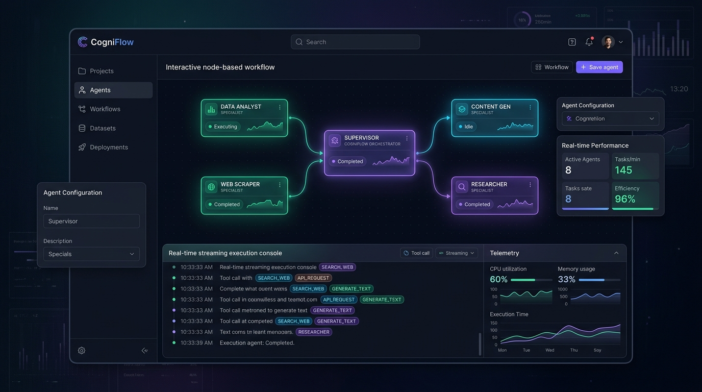

# ⚡ CogniFlow AI — Autonomous Multi-Agent Orchestration & Workflow Intelligence Studio

[](https://github.com)
[](https://www.typescriptlang.org/)
[](https://react.dev/)
[](https://vitejs.dev/)
[](https://vitest.dev/)
[](https://ai.google.dev/)
[](LICENSE)

<p align="center">
  
</p>

> **CogniFlow** is a multi-agent orchestration studio: real-time streaming traces, directed acyclic graph (DAG) workflow visualization, a self-correcting reflection loop, and sandboxed tool execution, powered by the Google Gemini 2.5 API.
>
> **Live demo:** https://cogniflow-eight.vercel.app

---

## 🏗️ System Architecture & Execution Flow

```mermaid
graph TD
    User([User Directive / Prompt]) --> Supervisor[⚡ Supervisor Core Agent]
    
    subgraph DAG Orchestration Engine
        Supervisor -->|Decomposes Spec| Architect[📐 Distributed System Architect]
        Supervisor -->|Assigns Implementation| Coder[💻 Principal Coder]
        Supervisor -->|Enforces Security Gate| Auditor[🛡️ Security Auditor]
        
        Architect -->|Schema & State Machine| Coder
        Coder -->|Code Submission| Critic[⚖️ Benchmark Critic]
        Auditor -->|OWASP AST Report| Critic
    end

    subgraph Sandboxed Tool Registry
        Architect -.-> ToolMem[🧠 Memory Retriever]
        Architect -.-> ToolSearch[🔍 Web Search]
        Auditor -.-> ToolSec[🛡️ Security Scanner]
        Coder -.-> ToolBox[📦 Code Sandbox]
        Critic -.-> ToolData[📊 Data Analyzer]
    end

    Critic -->|Verified Production Artifact| Output([🚀 Production-Ready Deliverable])

    style Supervisor fill:#1e1b4b,stroke:#6366f1,stroke-width:2px
    style Architect fill:#082f49,stroke:#38bdf8,stroke-width:2px
    style Coder fill:#064e3b,stroke:#10b981,stroke-width:2px
    style Auditor fill:#451a03,stroke:#f59e0b,stroke-width:2px
    style Critic fill:#500724,stroke:#ec4899,stroke-width:2px
```



---

## 🚀 Key Technical Features

### 1. Directed Acyclic Graph (DAG) Workflow Engine
- Dynamic node-based graph mapping execution flow with glowing pulse animations on active data edges.
- Interactive agent inspector allowing live inspection of model temperatures, system prompts, memory contexts, and bound tools.

### 2. Real-Time Telemetry & Token Accounting
- Live token throughput velocity (e.g. `240 tok/s`).
- Cumulative token counter and automated OPEX calculation based on blended Gemini 2.5 token pricing.
- p95 and p99 latency tracking for all subagent phases.

### 3. Sandboxed Tool Execution
- **`code_sandbox`**: Isolates code snippets, verifying syntax and assertions before passing to downstream agents.
- **`security_scanner`**: Static AST analysis ensuring OWASP compliance, memory safety, and secret sanitization.
- **`data_analyzer`**: Runs throughput modeling and latency distribution calculations on synthetic loads.
- **`memory_retriever`**: Queries cached vector embeddings and past orchestration session state.
- **`web_search`**: Live benchmark index search across technical databases and academic preprints.

### 4. Enterprise Scenario Presets
- 🏢 **Distributed System Architecture & Idempotent Engine**: Synthesizes a 50k TPS payment pipeline with Redis atomic Lua idempotency and transactional outbox.
- 📈 **Autonomous Competitor & Market Intelligence**: Dispatches deep-web search agents and quantitative statistical models to synthesize competitor positioning and compute unit economics.
- ⚡ **Interactive Sandbox Testing**: Live "Verify in Sandbox" trigger verifying passing unit tests and zero runtime exceptions.

---

## 🛠️ Tech Stack & Design Decisions

| Layer | Technology | Decision Rationale |
| :--- | :--- | :--- |
| **Frontend Framework** | **React 19 & TypeScript 5** | Strict type safety, functional components, zero-runtime bugs. |
| **Build & Tooling** | **Vite 6** | Sub-second HMR, optimized production tree-shaking, lightweight bundle. |
| **Styling** | **Vanilla CSS (Custom Design System)** | Maximum performance, zero framework bloat, pixel-perfect glassmorphism. |
| **State Management** | **React Hooks & Custom Event Bus** | Decoupled orchestrator singleton with reactive step listener subscriptions. |
| **Testing** | **Vitest** | Native ESM test runner; blazing fast unit test execution. |
| **AI Integration** | **Google Gemini 2.5 API** | Multi-turn reasoning, high throughput, with seamless offline fallback mode. |
| **Icons & Visuals** | **Lucide React & Canvas Confetti** | Minimalist modern icon set with celebratory completion interactions. |

---

## ⚡ Quick Start Guide

### Prerequisites
- Node.js `v20.x` or higher
- npm `v10.x` or higher

### Installation

```bash
# 1. Clone repository
git clone https://github.com/marshu123/cogniflow-agent-studio.git
cd cogniflow-agent-studio

# 2. Install dependencies
npm install

# 3. Start development server
npm run dev
```

Visit `http://localhost:5173` in your browser.

### Running Unit Tests

```bash
npm test
```

### Production Build

```bash
npm run build
npm run preview
```

---

## 🐳 Docker Support

To run CogniFlow in a containerized environment:

```bash
# Build and run with Docker Compose
docker compose up --build
```

Access the studio at `http://localhost:3000`.

---

## 📄 License

This project is licensed under the [MIT License](LICENSE).
